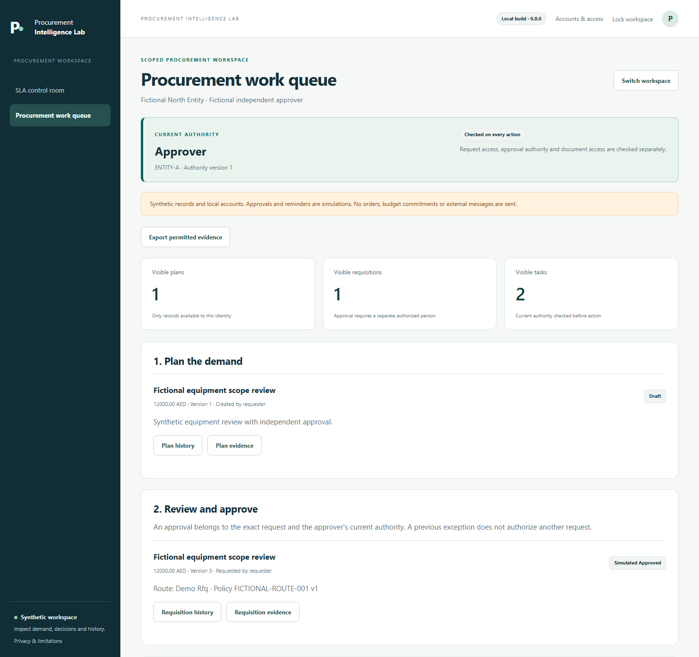

# Procurement Intelligence Lab

Public progress showcase for a procurement product being built from practical procurement questions, with AI-assisted engineering.

## Chunk 03 - Who is allowed to approve this request?

An approval needs an identifiable person, the right entity and current permission for the exact request. Version 0.8.0 adds named local accounts with requester, buyer, approver and viewer roles.

| Practical check | Demonstrated behavior |
| --- | --- |
| Can the requester approve their own request? | The original creator cannot approve it, even if they also hold the approver role. |
| Can another entity see the request? | Record views, history, exports and document downloads check the selected entity and current permissions. |
| What if the approver's permissions change? | The earlier decision remains in history but loses current authority. Restoring permissions does not revive it; a buyer must reopen review for a fresh decision. |
| Does record access grant every document? | Documents require parent-record visibility and an explicitly allowed role. |

*Actual screenshot of local build 0.8.0, captured 14 October 2026 using disposable fictional identities and records. Approvals are simulations. The sample amount is not a delegation threshold.*

The scope is deliberately precise: the approver must differ from the original creator. A person holding both buyer and approver roles may edit, route and approve another creator's request. Separate editor/router approval duties and monetary delegation rules are future work.

Clearer responsibility and less unauthorized rework are value hypotheses to measure; this demonstration does not claim customer outcomes.

## Chunk 02 · Remind while there is time to act

A useful first reminder helps prevent a missed deadline. Version 0.7.1 corrects the earlier overdue-only example and clearly separates preventive reminders from overdue follow-ups.

| Sample task event | Asia/Dubai time |
| --- | --- |
| Task ready | Friday 11 September 2026, 15:00 |
| First preventive reminder | **Friday, 16:00** |
| Task deadline | **Friday, 17:00** |
| Separate overdue follow-up, only if incomplete | Monday 14 September, 10:00 |

Fictional rules: Monday–Friday 09:00–17:00, quiet hours 16:30–10:00, two working hours to complete, one working hour of preventive notice, and an optional overdue follow-up one working hour after due. The first reminder is Friday; Monday is a separate overdue follow-up.

*Actual screen from local build 0.7.1, captured with disposable synthetic data. Actions create local simulation receipts; no message is sent.*

The product looks for an allowed contact before due, moving a planned contact earlier when quiet hours require it. If the target time passed but useful notice is still possible, it labels the reminder delayed. If no safe contact remains before due, it flags the missed preventive window. A preventive reminder cannot execute at or after the deadline or quietly become an overdue reminder.

Task completion, changed recipients and stale rules cancel pending attempts. Both reminder phases retain duplicate protection, cooldown and stable lifetime limits. Old policies require explicit review and reapplication; task deadlines and historical receipts remain preserved.

Reduced chasing and fewer missed deadlines remain user-value hypotheses to measure. The demonstration establishes the implemented rule and its local checks, not customer outcomes.

## Chunk 01 · Traceable demand, explainable SLA measurement and a bounded AI assistant

The first question is simple: can a reviewer follow a business need through its plan, requisition, changes and next responsible action—and understand the numbers shown along the way?

The current local build demonstrates:

| Procurement question | Implemented demonstration |
| --- | --- |
| Where did this request come from? | Versioned plans and demand lines, linked to planned requisitions; ad-hoc requests record a reason. |
| Can one request combine needs, or one need be split? | Value allocations support combined and split demand, with remaining-capacity checks. |
| What needs review when the source changes? | Affected intake loses its prior valid review state; unaffected intake retains its state. Revision history remains inspectable. |
| What should happen next? | A fictional routing policy, explicit simulated approval and dependent tasks make the next action visible. |
| Is the SLA number defensible? | Working calendars, pauses, reporting snapshots, exclusions and the completed-stage denominator are explicit. |

*Actual screenshot of local build 0.6.0, captured on 8 September 2026 from disposable synthetic data. This is a viewport capture of the running application.*

The worked example runs from Friday at 16:00 to Monday at 11:00. Under the displayed Monday–Friday, 09:00–17:00 demonstration calendar, that is **67 elapsed hours and 3 working hours**. The sample completion rate is **2 of 3 eligible completed stages (66.7%)**. Neither figure is a customer result or an end-to-end procurement performance claim.

## Current limits

This is a local development product supporting named accounts and entity-scoped permissions in one application process, alongside a preserved legacy owner exercise. Approvals and reminders are simulations. It does not place orders, reserve budget, contact suppliers, connect to an ERP or establish enterprise identity and monetary delegation. Plan values, requisition values and allocations describe different views of demand and must not be added together as spend.

## AI-01 · Explain a synthetic SLA snapshot

The first AI capability is implemented as an owner-triggered explanation flow. It presents the authoritative SLA facts for review, asks for explicit agreement before sending those facts to OpenAI, and is designed to display advisory observations linked to evidence alongside what remains unknown.

*Actual 0.6.0 preview screen. This image shows the review step; no generated answer has been inserted or fabricated.*

This first capability accepts only the unchanged bundled synthetic SLA facts. It cannot change calculations or take procurement actions. A citation points to an input fact; it does not prove that an AI-generated interpretation is correct. The person reviewing the explanation remains responsible for checking it.

**The request path and preview are implemented; live-provider validation and explanation-quality evaluation are still pending.** The screenshots do not demonstrate a successful live AI response. Later candidates include clarifying incomplete requests and identifying missing information, subject to evidence and testing.

## What has been checked

**The 0.8.0 release passed 639 automated tests**, with no failures, errors or skips. Actual sandboxed desktop/mobile browser checks covered named roles, entity and document boundaries, self-approval denial and approval by someone other than the original request creator. Existing SLA, demand and preventive-reminder flows passed. A fresh runtime-only installation passed 25 checks and all 36 packaged files matched source; nine Windows launcher checks passed. No live AI call or real message was sent.

The historical corrected 0.7.1 release passed 517 automated tests, with no failures, errors or skips. Real sandboxed desktop/mobile browser checks demonstrated preventive contact before due and a separately identified overdue follow-up. A fresh runtime-only installation and nine Windows launcher checks passed. No live AI call or real message was sent.

The historical 0.7.0 release passed **448 automated tests**, with zero failures, errors or skips. Sandboxed desktop/mobile browser checks exercised both existing workflows and the new schedule controls, including early-dispatch rejection and duplicate prevention. A fresh runtime-only installation and nine Windows launcher checks also passed. Those 0.7.0 checks used disposable synthetic state and made no live AI calls; they are historical and do not verify this correction.

The preceding 0.6.0 release passed 301 tests; that count is historical.

The Chunk 01 screenshots were captured from the running 0.6.0 product with disposable synthetic state. Additional browser checks verified the AI preview at desktop and mobile widths, its required disclosure checkbox and rejection of a request without that disclosure. Provider transport and credential reading were blocked during screenshot capture. They remain historical evidence for that release.

These are development checks on synthetic scenarios; they are not a security certification or evidence of enterprise readiness.

Future priorities will be selected using observed user problems, current market evidence and measurable acceptance criteria. Potential value is a hypothesis until tested with an appropriate baseline.

## Repository boundary

This public repository contains showcase documentation and reviewed synthetic screenshots. The product implementation and its source history are maintained in a separate private repository. Personal publishing tools are a separate private project. This showcase contains no source-code distribution, live application or confidential procurement data.

Public showcase: [Procurement Intelligence Lab on GitHub](https://github.com/mmdoh1995/procurement-intelligence-lab-showcase).

Feedback is welcome: which handoff causes the most avoidable rework in your procurement process—planning, intake completeness, approval ownership or understanding cycle time?
