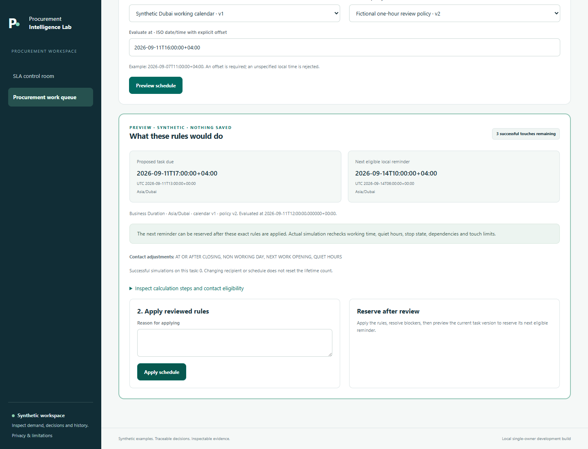
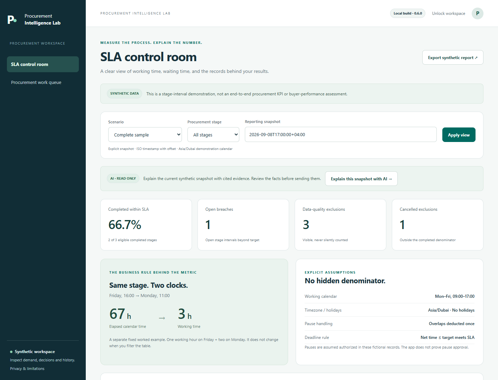
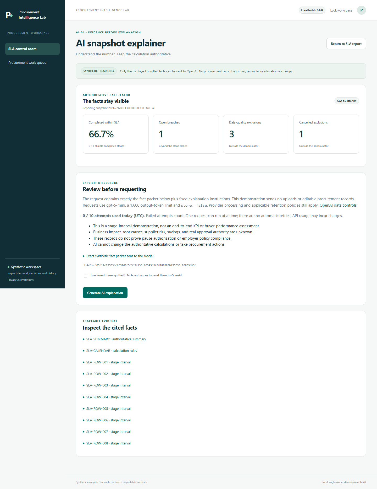

# Procurement Intelligence Lab

Public progress showcase for a procurement product being built from practical procurement questions, with AI-assisted engineering.

## Chunk 02 · Keep the deadline visible; time the reminder appropriately

An approval task is due at 17:00 on Friday. The recipient's contact window has already closed. The deadline should stay visible while the reminder waits for an allowed time.

The new local build separates those two decisions:

| Sample rule | Result |
| --- | --- |
| Ready Friday 11 September 2026 at 16:00; 60 working minutes to complete | Task due Friday at **17:00** |
| Monday–Friday, 09:00–17:00; quiet hours 16:30–10:00 | Next eligible reminder Monday 14 September at **10:00** |

All example times use Asia/Dubai. The calendar and policy are fictional and configurable. Quiet hours affect contact eligibility; they do not extend the task deadline.

*Actual screen from local build 0.7.0, captured with disposable synthetic data. Reminder actions record local simulation receipts; no message is sent.*

Before a simulated reminder goes ahead, the product rechecks the task, dependencies, configuration versions, recipient and contact window. Calendar or policy edits make affected schedules stale and cancel pending reservations. Completed or obsolete work also cancels its pending reminders. Duplicate reservations reuse the existing attempt, and successful-touch limits persist across schedule and recipient changes.

Existing tasks keep their recorded deadlines until the owner explicitly applies a calendar policy. The preview shows what would change before it is applied. Saved deadlines, proposed deadlines and the next eligible contact time remain distinct.

This helps a reviewer inspect the timing and reason for a follow-up. Reduced workload or faster procurement remains a value hypothesis to test with users.

## Chunk 01 · Traceable demand, explainable SLA measurement and a bounded AI assistant

The first question is simple: can a reviewer follow a business need through its plan, requisition, changes and next responsible action—and understand the numbers shown along the way?

The current local build demonstrates:

| Procurement question | Implemented demonstration |
| --- | --- |
| Where did this request come from? | Versioned plans and demand lines, linked to planned requisitions; ad-hoc requests record a reason. |
| Can one request combine needs, or one need be split? | Value allocations support combined and split demand, with remaining-capacity checks. |
| What needs review when the source changes? | Affected intake loses its prior valid review state; unaffected intake retains its state. Revision history remains inspectable. |
| What should happen next? | A fictional routing policy, explicit simulated approval and dependent tasks make the next action visible. |
| Is the SLA number defensible? | Working calendars, pauses, reporting snapshots, exclusions and the completed-stage denominator are explicit. |

*Actual screenshot of local build 0.6.0, captured on 8 September 2026 from disposable synthetic data. This is a viewport capture of the running application.*

The worked example runs from Friday at 16:00 to Monday at 11:00. Under the displayed Monday–Friday, 09:00–17:00 demonstration calendar, that is **67 elapsed hours and 3 working hours**. The sample completion rate is **2 of 3 eligible completed stages (66.7%)**. Neither figure is a customer result or an end-to-end procurement performance claim.

## Current limits

This is a local, single-owner development product. Approvals and reminders are simulations. It does not place orders, reserve budget, contact suppliers, connect to an ERP or establish multi-user approval authority. Plan values, requisition values and allocations describe different views of demand and must not be added together as spend.

## AI-01 · Explain a synthetic SLA snapshot

The first AI capability is implemented as an owner-triggered explanation flow. It presents the authoritative SLA facts for review, asks for explicit agreement before sending those facts to OpenAI, and is designed to display advisory observations linked to evidence alongside what remains unknown.

*Actual 0.6.0 preview screen. This image shows the review step; no generated answer has been inserted or fabricated.*

This first capability accepts only the unchanged bundled synthetic SLA facts. It cannot change calculations or take procurement actions. A citation points to an input fact; it does not prove that an AI-generated interpretation is correct. The person reviewing the explanation remains responsible for checking it.

**The request path and preview are implemented; live-provider validation and explanation-quality evaluation are still pending.** The screenshots do not demonstrate a successful live AI response. Later candidates include clarifying incomplete requests and identifying missing information, subject to evidence and testing.

## What has been checked

The current 0.7.0 release passed **448 automated tests**, with zero failures, errors or skips. Sandboxed desktop/mobile browser checks exercised both existing workflows and the new schedule controls, including early-dispatch rejection and duplicate prevention. A fresh runtime-only installation and nine Windows launcher checks also passed. These checks used disposable synthetic state and made no live AI calls.

The preceding 0.6.0 release passed 301 tests; that count is historical.

The Chunk 01 screenshots were captured from the running 0.6.0 product with disposable synthetic state. Additional browser checks verified the AI preview at desktop and mobile widths, its required disclosure checkbox and rejection of a request without that disclosure. Provider transport and credential reading were blocked during screenshot capture. They remain historical evidence for that release.

These are development checks on synthetic scenarios; they are not a security certification or evidence of enterprise readiness.

Future priorities will be selected using observed user problems, current market evidence and measurable acceptance criteria. Potential value is a hypothesis until tested with an appropriate baseline.

## Repository boundary

This public repository contains showcase documentation and reviewed synthetic screenshots. The product implementation and its source history are maintained in a separate private repository. Personal publishing tools are a separate private project. This showcase contains no source-code distribution, live application or confidential procurement data.

Public showcase: [Procurement Intelligence Lab on GitHub](https://github.com/mmdoh1995/procurement-intelligence-lab-showcase).

Feedback is welcome: which handoff causes the most avoidable rework in your procurement process—planning, intake completeness, approval ownership or understanding cycle time?
